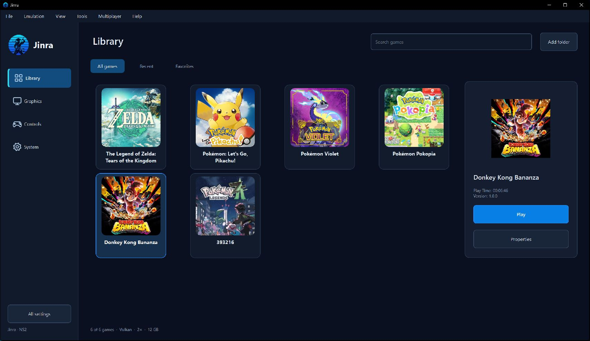
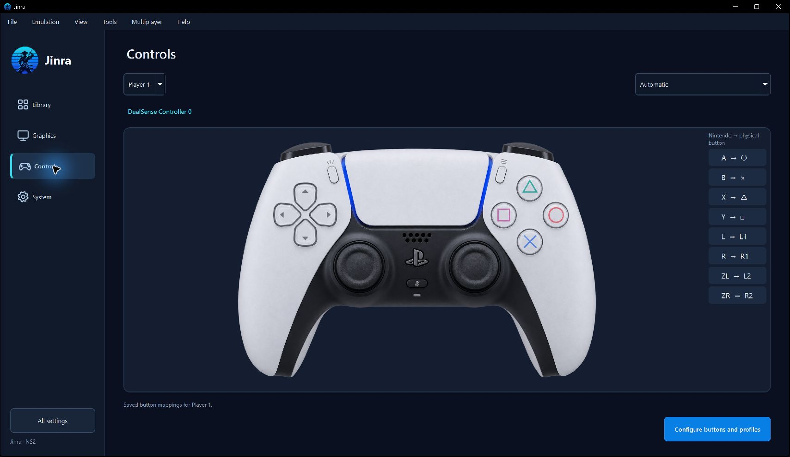

# Jinra

Jinra is an experimental fork of [Eden-NS2](https://github.com/0x2593/Eden-NS2),
building on the work of Eden and yuzu. It combines Switch 2 emulation changes,
Donkey Kong Bananza rendering and performance work, and a new desktop interface.

## Testing scope — please read first

Jinra is optimized and tested on Windows with NVIDIA graphics and Vulkan.
Results on AMD graphics are unknown. Compatibility on other GPU configurations
and operating systems remains unverified.

| Game | Tested environment | Current scope |
| --- | --- | --- |
| Donkey Kong Bananza | Windows, NVIDIA GPU, Vulkan | Rendering and performance changes tested in gameplay. The owner also verified loading a `.nup` dump. |
| Pokémon Pokopia | Windows, GeForce RTX 5090, Vulkan | Introductory cinematic, tutorial and movement verified. The project owner reported a stable 60 FPS at 2× in the tested gameplay. |
| All other games | No Jinra gameplay results | Compatibility and performance unknown |

The 60 FPS result applies to the tested hardware, settings and gameplay.

## Screenshots

These are real captures of the Jinra desktop interface. Games appearing in the
library are examples of detection, not additional compatibility test results.

### Library

### Controls

The Windows session below automatically detected a DualSense controller.

## What is included

- Rendering, synchronization and buffer-handling work developed while testing
  Donkey Kong Bananza on NVIDIA hardware.
- A targeted NVIDIA Vulkan workaround for the Pokémon Pokopia introductory
  cinematic crash. See [the technical notes](docs/upstream-pokopia-fixes.md).
- Jinra branding, the samurai icon and a redesigned desktop library.
- Library search, Recent and Favorites views, and a selected-game panel.
- Xbox and DualSense layout previews, SDL device detection and physical button
  labels. Virtual-controller checks passed; physical-device behavior still needs
  broader verification.
- The existing interface-language catalog and advanced settings.
- Detection of `.nup` games in the library and file picker, with experimental
  NUP v1 loading for raw and Zstandard-compressed members, including
  a base program and its newest bundled update.

NUP support passed container-fixture tests. **Donkey Kong Bananza was also
successfully tested from a `.nup` dump by the project owner.** This does not
establish compatibility with other games or every NUP layout. Bundled DLC records
are recognized but are not mounted. See [NUP support](docs/nup-jinra.md) for details
and attribution.

## Defaults and performance

New configurations start with English and the Jinra theme, plus:

| Setting | Default |
| --- | --- |
| Graphics backend | Vulkan |
| Emulated memory | 12 GB |
| Console mode | Handheld |
| Resolution scale | 2x |
| Scaling filter | ScaleForce |
| Anti-aliasing | SMAA |
| GPU accuracy | High / Accurate |
| Asynchronous shader building | Enabled |
| Video decoding | GPU |
| VRAM usage mode | Aggressive |

These are the settings used during development, not universal recommendations
for every PC. Existing saved preferences and per-game overrides take precedence.
If 2x is too demanding for your system, try 1x. Resolution scaling multiplies the
game's internal render size, which can vary by game, scene and console mode.

See [the desktop interface notes](docs/jinra-ui.md) for controller, artwork,
language and profile behavior. New initial profiles use the Jinra name and logo;
existing profile identifiers and save associations are preserved.

## Running

### Windows installer and updates

Download the Windows x64 installer from [Releases](https://github.com/JinWooPT/Jinra/releases).
It installs for the current user and provides a Start menu entry, an optional
desktop shortcut and an uninstaller. Existing data in the installation's `user`
folder is retained during upgrades and uninstallation.

Use **Help > Check for updates...** to check GitHub Releases. Startup checks follow
the existing **Check for updates** preference. The updater recognizes newer Jinra
preview and stable versions, verifies the downloaded installer's size and SHA-256
digest, and asks before closing the app and starting the installer. Installation
is blocked while a game is running. No game files or user data are uploaded.

The installer and update support are for Windows x64. Other platforms remain
unverified. Source builders can run the focused update tests by configuring
`-DJINRA_UPDATE_TESTS=ON` and building the `jinra_update_tests` target.

### Game setup

Use your own game dumps and any required keys and firmware. No games, keys,
firmware, user profiles, saves or shader caches are distributed with Jinra.

**Use Switch 2 firmware 23.0.0 for the tested builds of Donkey Kong Bananza and
Pokémon Pokopia.** The tested Bananza build stalled at launch with firmware
22.5.0. The installer preserves existing firmware, so install your own 23.0.0
dump under **Tools > Install Firmware** and check the reported version in the
status bar.

Add your game folder in the Library or use **File > Load File**. Extracted dumps
are supported; for that layout, keep `romfs` alongside `exefs`.

The desktop executable is `jinra.exe` on Windows. Internal storage and some
configuration keys retain their upstream names for compatibility.

## Building from source

The existing CMake desktop target is still named `yuzu`; its output has been
renamed to `jinra`. General dependency instructions are in [docs/Deps.md](docs/Deps.md).

For Windows, the inherited [MSVC build helper](build-eden-msvc.bat) is available.
It requires Visual Studio or Build Tools with Desktop development with C++,
CMake, Ninja, Git for Windows and the dependencies described in the build docs.
The helper retains its upstream filename and some legacy output messages;
look for `jinra.exe` in the build output directory.

The local development build was validated with MSVC, Release, LTO and a locally
trained optimization profile. That private build directory and profile are not
part of the repository. Rebuilding with another toolchain or without that
profile may change performance; the published source is not a claim of identical
binaries across build environments.

Existing upstream Linux and other-platform build instructions remain in the
documentation. These platforms have not been tested with Jinra.

## Reporting results

Include the Jinra commit or version, game version, GPU model, driver version,
operating system and relevant settings. AMD reports are especially useful because
this project's AMD behavior is currently unknown. Do not attach game data, keys,
firmware or private user files.

## Credits, license and development disclosure

Jinra is derived from [0x2593/Eden-NS2](https://github.com/0x2593/Eden-NS2),
[Eden](https://git.eden-emu.dev/eden-emu/eden) and yuzu. Original copyright,
license and contributor notices are retained. The tested Jinra source was based
on Eden-NS2 commit `c3dd05fb279b0e5b330964bf9983e4a88edc326e`.

NUP loading is adapted from a55uka's format and Eglantine's GPL-licensed reader;
the pinned source and limitations are documented in [docs/nup-jinra.md](docs/nup-jinra.md).

This fork was developed with substantial AI assistance, including code changes,
tests, interface artwork and documentation. It remains experimental and needs
further human review and testing.

Jinra is not affiliated with or endorsed by Nintendo, Eden or the yuzu project.
The project is distributed under **GPL-3.0-or-later**; see [LICENSE.txt](LICENSE.txt)
and [LICENSES](LICENSES) for the retained license texts and notices.
